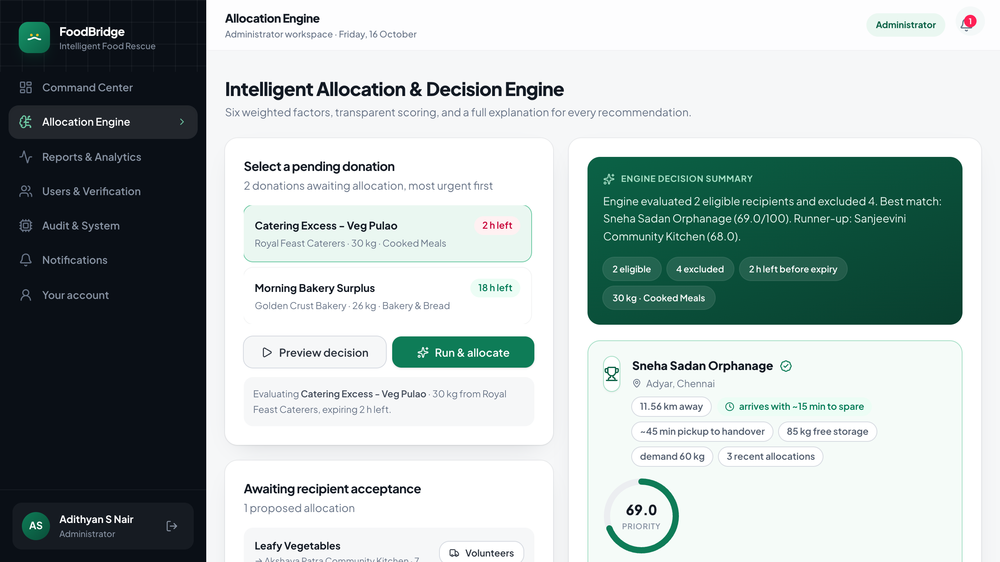
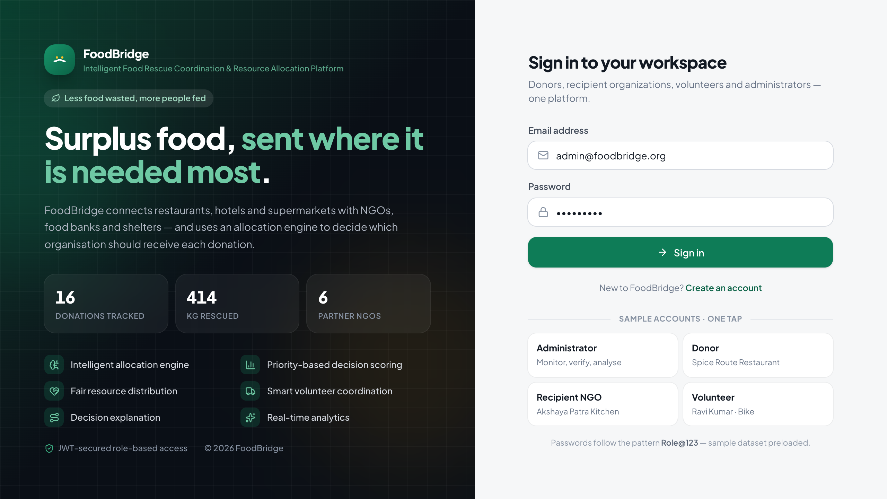
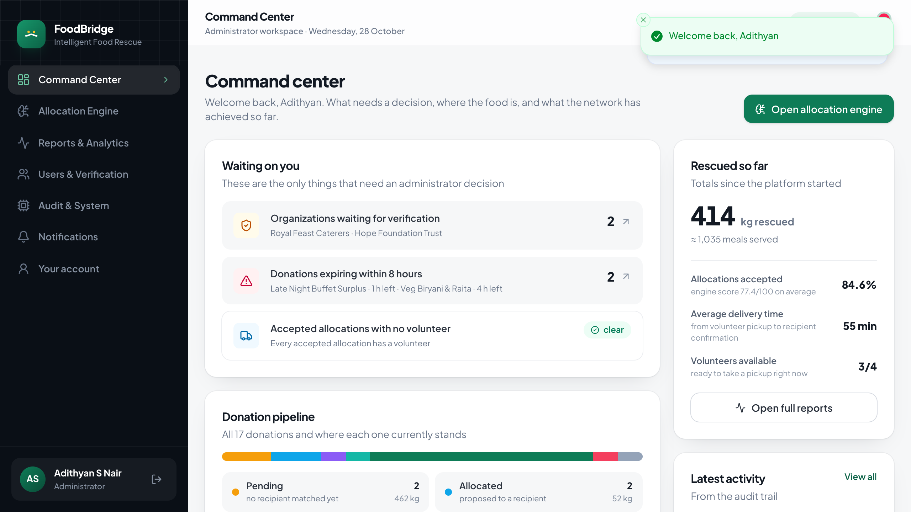
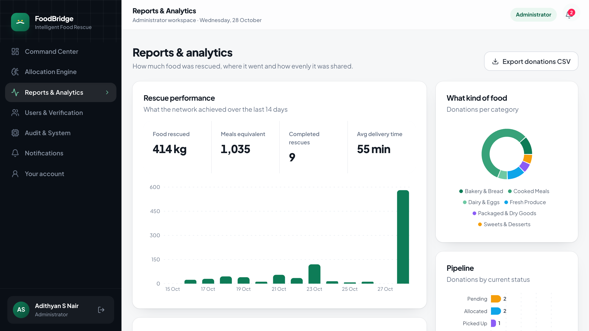
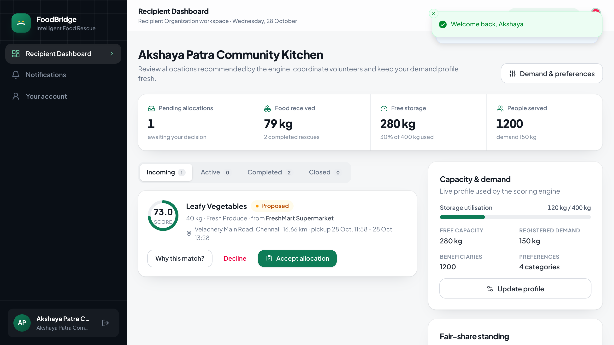
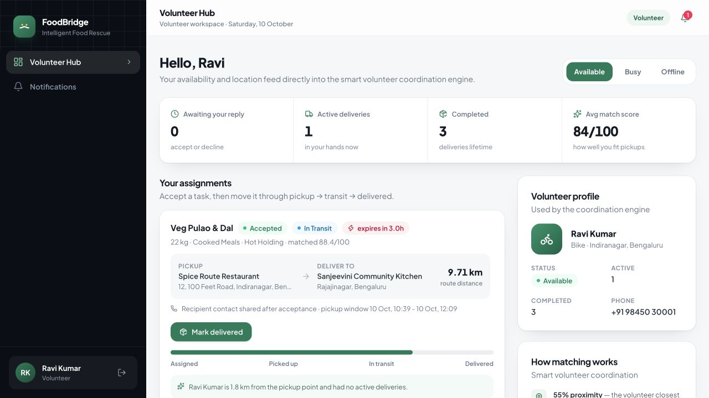

# FoodBridge
### An Intelligent Food Rescue Coordination and Resource Allocation Platform

**Adithyan S Nair · 24BAI1621**

Restaurants, hotels, supermarkets and caterers throw away surplus food that is still perfectly
safe to eat, while NGOs, food banks and shelters struggle to meet demand. FoodBridge doesn't
just connect donors with recipients. Its **Intelligent Allocation & Decision Engine** runs the
moment food is registered: it removes organizations that cannot take the food safely, scores the
rest across six weighted factors, explains the choice and hands the rescue to the closest
volunteer. An administrator can replace the recipient at any point before collection, and the
record keeps the original decision, the change and the reason for it.



---

## Quick start

**Requirements:** Java 21, Node.js 20 or newer, npm, and MySQL 8 or newer. The start script expects
a MySQL server on port 3307; it starts the bundled local instance automatically if one is already
configured in `~/.foodbridge`.

```bash
./scripts/start-all.sh      # MySQL (3307) + Spring Boot API (8080) + React app (5173)
```

Then open **http://localhost:5173** and sign in with any sample account:

| Role | Email | Password | Represents |
|---|---|---|---|
| Administrator | `admin@foodbridge.org` | `Admin@123` | Platform oversight |
| Donor | `donor@foodbridge.org` | `Donor@123` | Spice Route Restaurant |
| Recipient Organization | `recipient@foodbridge.org` | `Recipient@123` | Akshaya Patra Community Kitchen |
| Volunteer | `volunteer@foodbridge.org` | `Volunteer@123` | Ravi Kumar (Bike) |

Stop everything with `./scripts/stop-all.sh`.

### Environment variables

The defaults work for a local demo. Override them in the shell (or in your IDE run
configuration) when you move the project to another machine. Do not commit real passwords or
keys.

| Variable | Default | Used for |
|---|---|---|
| `FOODBRIDGE_DB_URL` | `jdbc:mysql://127.0.0.1:3307/foodbridge?useSSL=false&allowPublicKeyRetrieval=true&serverTimezone=Asia/Kolkata` | MySQL connection |
| `FOODBRIDGE_DB_USER` | `foodbridge` | MySQL user |
| `FOODBRIDGE_DB_PASS` | `foodbridge123` | MySQL password (demo value only) |
| `FOODBRIDGE_JWT_SECRET` | development key in `application.properties` | Signing JWT tokens (`foodbridge.jwt.secret`); replace it for any real deployment |
| `FOODBRIDGE_DEMO_SEED` | `true` | Load the sample dataset on first boot (`foodbridge.demo.seed`) |
| `FOODBRIDGE_ENGINE_AUTOALLOCATE` | `true` | Match every new donation automatically (`foodbridge.engine.auto-allocate`); `false` restores manual runs |

JWT secrets and database passwords belong in the environment, never in the repository, for a
deployed build.

**Prefer a Desktop shortcut?** Run `./scripts/make-desktop-launcher.sh` once — it creates
**FoodBridge.command** (starts everything and opens the site) and **Stop FoodBridge.command** on
your Desktop. Double-click either one; the first launch may ask to let Terminal access your
Documents folder, and after that it just works.

<details>
<summary>Manual setup (three terminals)</summary>

```bash
# 1. database — dedicated MySQL 26.7 instance on port 3307, data in ~/.foodbridge/mysql-data
./scripts/start-mysql.sh

# 2. backend — Spring Boot 4 / Java 21 REST API on :8080
cd backend && ./mvnw spring-boot:run

# 3. frontend — React 19 + Vite dev server on :5173 (proxies /api to :8080)
cd frontend && npm install && npm run dev
```

No MySQL handy? Run the API with the embedded H2 profile instead:
`cd backend && ./mvnw spring-boot:run -Dspring-boot.run.profiles=h2`
</details>

The database seeds itself on first boot with a realistic Chennai scenario — 5 donor
businesses, 6 recipient organizations, 4 volunteers and two weeks of donation history.
Admin → **Audit & System** can restore that sample dataset at any time.

---

## Core features

1. **User authentication & role management** — JWT login with role-based access for donors,
   recipient organizations, volunteers and administrators. Anyone can sign up from the
   **Create account** page; donors can be a restaurant, hotel, supermarket, bakery, caterer,
   company, NGO — or an individual donating personally.
2. **Food donation management** — donors register surplus food with category, quantity, expiry
   window, storage requirement and pickup point, modify it until a recipient accepts, cancel it
   before collection, and track it through its lifecycle.
3. **Recipient management** — organizations maintain their demand, storage capacity,
   beneficiaries and accepted food categories; all of it feeds the engine.
4. **Intelligent Allocation & Decision Engine** — matches a donation automatically when it is
   registered. Eligibility filters plus six weighted factors produce a ranked recommendation:
   expiry urgency 25%, demand match 20%, storage fit 15%, proximity 15%, food preference 15%,
   fairness 10%.
5. **Priority-based decision scoring** — every allocation stores its 0–100 score and the exact
   per-factor breakdown that produced it.
6. **Administrator override** — the administrator can replace the engine's recipient while
   nothing has been collected. The record keeps the engine's own score, the previous recipient,
   the new recipient and the reason for the change, and everyone involved is notified.
7. **Fair resource distribution** — the fairness factor scores recipients by kilograms received
   in the last 30 days so distribution stays balanced, measured on the analytics dashboard.
8. **Smart volunteer coordination** — volunteers are matched by proximity (55%), current load
   (25%) and experience (20%), with a written match explanation.
9. **Delivery tracking** — pickup → in transit → delivered → recipient confirmation, updating
   storage load, volunteer records and the donation status.
10. **Notification & tracking** — in-app notifications for every lifecycle event, plus automated
   expiry alerts.
11. **Reports & analytics** — rescue KPIs, 14-day trend, category mix, pipeline funnel, fairness
    distribution, volunteer leaderboard and CSV export.
12. **Administrative oversight** — organization verification, user management, audit logs and
    live system health.
13. **Profile management** — every role can update their name, phone and address from the
    account page; volunteers also manage their vehicle, recipients manage demand from their
    dashboard.

**Eligibility filters** run before scoring: only verified organizations, only recipients with
enough free storage, only organizations that accept that food category — and only organizations
the food can actually reach in time.

### Original contribution: the food-safety arrival rule

Before scoring, the engine estimates the pickup-to-handover time for every organisation
(distance ÷ 20 km/h city travel + 10 min handling) and compares it with the time left on the
food's safe window, keeping a 60-minute serving buffer. **Organisations that cannot receive the
food safely are excluded with a written reason** rather than quietly scoring lower — e.g.
*"the trip needs about 85 min (travel + handling) but only 60 min are available before the safe
window closes"*. Winners show how much time they have to spare.

It is visible on the Allocation Engine page with the seeded dataset, and the reasoning behind it
— including the assumptions and the alternatives that were rejected — is documented in
[`docs/DESIGN_DECISIONS.md`](docs/DESIGN_DECISIONS.md).

---

## Screenshots

| | |
|---|---|
|  |  |
|  |  |
|  |  |

More in [`docs/screenshots/`](docs/screenshots/) — the donor workspace, the sign-up flow and
the analytics detail views.

---

## Architecture

Matches the submitted Lab 3 system architecture diagram — layered, modular, and each layer maps
1:1 to a folder in the repo.

```
┌───────────────────────────────────────────────────────────────────────┐
│ Presentation Layer · React 19 + TypeScript + Tailwind v4 + Recharts   │
│  Login · sign up · role dashboards · allocation engine · analytics    │
└───────────────────────────────┬───────────────────────────────────────┘
                                │ REST + JWT (Bearer)
┌───────────────────────────────▼───────────────────────────────────────┐
│ Application Layer · Spring Boot 4 REST controllers                    │
│  Auth · Donation · Recipient · Volunteer · Allocation · Notification  │
│  Analytics · Admin · Sample data                                      │
├───────────────────────────────────────────────────────────────────────┤
│ Business Logic Layer · services & rules                               │
│  AuthService · DonationService · RecipientService · VolunteerService  │
│  DeliveryService · AnalyticsService · AdminService · DataSeeder       │
│  ★ AllocationEngineService — filters, weighted scoring, fairness,     │
│    volunteer matching, decision explanations                          │
├───────────────────────────────────────────────────────────────────────┤
│ Data Access Layer · Spring Data JPA repositories                      │
├───────────────────────────────────────────────────────────────────────┤
│ MySQL 26.7 · database `foodbridge` · 12 entities (3NF)                │
└───────────────────────────────────────────────────────────────────────┘
```

**Security:** Spring Security 7 with a stateless JWT filter, BCrypt password hashing,
role-based authorization (`ADMIN`, `DONOR`, `RECIPIENT`, `VOLUNTEER`) on both endpoints
and method level, plus per-record ownership checks (a recipient can only accept *its own*
allocations, a volunteer only *its own* assignments).

## Database — the 12 entities from the ER diagram

`User` (parent, 1:1 role profiles) → `Donor`, `RecipientOrganization`, `Volunteer`.
`FoodDonation` (N:1 donor, N:1 category) → `Allocation` (1:1 donation, N:1 recipient) →
`VolunteerAssignment` (1:1 allocation, N:1 volunteer) → `Delivery` (1:1 assignment).
Supporting: `FoodCategory`, `RecipientPreference` (bridge for M:N), `Notification`, `AuditLog`.

## Class diagram mapping

The submitted class diagram is implemented directly: `User` (parent with common fields),
`Donor`, `RecipientOrganization`, `Volunteer`, `Administrator`, `FoodDonation`,
`FoodCategory`, `Allocation`, `VolunteerAssignment`, `Delivery`, `Notification`, `AuditLog`
and the independent `AllocationEngine` service, plus the `UserRole`, `DonationStatus`,
`AssignmentStatus`, `DeliveryStatus` enumerations and composition chains
(`FoodDonation → Allocation → VolunteerAssignment → Delivery`).

---

## Use cases implemented

| Actor | Use cases |
|---|---|
| Donor | Authenticate · manage profile · register, modify and cancel donations · preview the engine's recommendation for their own donation · view donation history · receive notifications |
| Recipient Organization | Update food demand & capacity · view available allocations · accept allocation · confirm delivery · manage food preferences |
| Volunteer | Update availability · manage assignments · accept/decline · track delivery (pickup → in transit → delivered) |
| Administrator | Verify organizations · manage users · monitor system (health + audit) · generate reports (CSV export) · view audit logs |

## Who sees what

| Workspace | Screens |
|---|---|
| Donor | Donor dashboard (own donations, preview match, history) · Notifications |
| Recipient organization | Recipient dashboard (incoming allocations, demand & preferences) · Notifications |
| Volunteer | Volunteer hub (availability, assignments, delivery tracking) · Notifications |
| Administrator | Command center · Allocation engine · Reports & analytics · Users & verification · Audit & system · Notifications |

Every endpoint is enforced server-side as well (401 without a token, 403 for the wrong role),
so a donor can never read platform-wide allocation or analytics data.

## End-to-end workflow

Every rescue follows the same path, each step performed by the role that owns it:

`Donor registers surplus food → the engine matches a recipient automatically → recipient accepts →
volunteer collects, delivers and marks it delivered → recipient confirms receipt →
analytics and the audit trail update`

When no organization is eligible, the donation stays in the waiting queue with the reason written
to the audit trail. The queue is retried when an organization updates its storage capacity or is
verified, so a waiting donation is picked up without anyone pressing a button. The administrator
can also re-run the engine for a waiting donation, and can override any decision before collection.

A presentation run sheet — what to click, in what order, and what to say — is in
[`docs/DEMO_SCRIPT.md`](docs/DEMO_SCRIPT.md).

---

## REST API (summary)

| Method & path | Purpose |
|---|---|
| `POST /api/auth/register` · `POST /api/auth/login` · `GET /api/auth/me` | JWT authentication & profile |
| `GET/POST /api/donations` · `POST /api/donations/{id}/cancel` · `GET /api/donations/expiring` | Donation lifecycle |
| `POST /api/allocations/engine/{donationId}/preview` · `/run` | Run the decision engine (ranked, explained) |
| `GET /api/allocations` · `/{id}/accept` · `/{id}/reject` · `/{id}/confirm-delivery` | Allocation decisions |
| `GET /api/allocations/{id}/volunteer-matches` · `POST /{id}/assign-volunteer` | Smart volunteer coordination |
| `GET /api/recipients` · `/me` · `PATCH /me/demand` · `GET/PUT /me/preferences` | Recipient demand & preferences |
| `GET /api/volunteers` · `/me/assignments` · `POST /assignments/{id}/{accept,decline,start,in-transit,delivered}` | Volunteer & delivery tracking |
| `GET /api/notifications` · `/unread-count` · `POST /{id}/read` · `/read-all` | Notification center |
| `GET /api/analytics/overview` · `GET /api/analytics/export/donations.csv` | Reports & analytics |
| `GET /api/admin/users` · `POST /users/{id}/verify` · `PATCH /users/{id}/status` · `GET /audit-logs` · `GET /system-health` | Admin oversight |
| `POST /api/admin/sample-data/restore` | Reload the sample dataset (administrator) |

Public: `GET /api/public/categories`, `/engine-weights`, `/platform-stats`.
Health: `GET /actuator/health`.

---

## Project structure

```
FoodBridge/
├── backend/                     Spring Boot 4 API (Java 21)
│   └── src/main/java/com/foodbridge/
│       ├── domain/              12 JPA entities + 10 enums
│       ├── repo/                Spring Data repositories
│       ├── service/             business logic incl. the allocation engine
│       ├── web/                 REST controllers
│       ├── security/            JWT service, filter, principal
│       └── config/              security, CORS, sample data seeding
├── frontend/                    React 19 + TypeScript + Tailwind v4
│   └── src/
│       ├── pages/               login, 4 role workspaces, engine, analytics,
│       │                        users, audit/system, account
│       ├── components/          app shell, charts, recommendation panel, UI kit
│       ├── store/               auth context
│       └── lib/                 axios client, typed DTOs, formatters
├── scripts/                     start-all / start-mysql / stop-all
├── docs/
│   ├── screenshots/             UI screenshots
│   ├── DESIGN_DECISIONS.md      the rules I chose, and the alternatives I rejected
│   ├── DEMO_SCRIPT.md           presentation walkthrough
│   ├── SUBMISSION.md            Lab 09 links, setup and submission checklist
│   ├── AdiByte5_FoodBridge_Presentation.pptx
│   └── AdiByte5_FoodBridge_Presentation.pdf
└── preContent/                  the original submitted lab PDFs
```

## Running the tests

```bash
cd backend && ./mvnw test
```

Fifteen automated tests run against an in-memory H2 database, so they do not touch your MySQL data:

- **AllocationEngineServiceTest** — eligibility filters (unverified, insufficient storage, category
  mismatch), the food-safety arrival rule rejecting an organisation that cannot receive the food
  in time, weighted scoring and factor totals, and the fairness factor preferring the
  organization that received less.
- **ApiAccessTest** — unauthenticated requests return 401, a donor is blocked from admin-only
  endpoints with 403, recipients only reach their own allocations, the administrator can read
  platform data, and an individual can sign up as a donor under their own name.
- **AllocationFlowTest** — registering a donation matches it automatically, a donation that no
  organization can take stays in the queue, freeing storage retries the queue, an administrator can
  override the recipient with a written reason, the same organization and unverified organizations
  are refused, volunteer assignment returns a complete record, and only the administrator can
  override a decision.

## Lab 09 submission

**Team:** AdiByte5 · **Member:** Adithyan S Nair (24BAI1621) · **Course:** Software Engineering
Laboratory (PTPS)

| Deliverable | File or link |
|---|---|
| Presentation | [`docs/AdiByte5_FoodBridge_Presentation.pptx`](docs/AdiByte5_FoodBridge_Presentation.pptx) · [`docs/AdiByte5_FoodBridge_Presentation.pdf`](docs/AdiByte5_FoodBridge_Presentation.pdf) |
| Source code | https://github.com/25-26-WIN-BCSE301L-SOFTWARE-ENGINEERING/26-27-fall-se-lab-projects-AdiByte5 |
| Public copy of the code | https://github.com/AdiByte5/FoodBridge |
| Demo video | Upload the recording to Teams and set it to **Anyone with the link can view** |
| Live application | Not publicly deployed. Run it locally at `http://localhost:5173` with `./scripts/start-all.sh`. |
| Submission notes | [`docs/SUBMISSION.md`](docs/SUBMISSION.md) |

The checks for a clean submission:

```bash
cd backend && ./mvnw test       # 15 tests, in-memory database
./scripts/start-all.sh          # MySQL 3307, API 8080, site 5173
open http://localhost:5173
```

The presentation deck has speaker notes and uses the Lab 3 architecture and Lab 4 ER diagrams.

## Troubleshooting

| Symptom | Fix |
|---|---|
| `Port 8080 already in use` | `./scripts/stop-all.sh` then start again |
| API starts but data looks empty | Admin → **Audit & System** → *Restore sample data* |
| MySQL will not start | Check `~/.foodbridge/run/mysqld.log`; make sure nothing else uses port 3307 |
| Want a zero-install database | Run the API with `-Dspring-boot.run.profiles=h2` |

---

*Course: PTPS — project deliverables Lab 1–8 (synopsis, requirements, architecture, ER model,
use case & class diagrams, sequence & activity diagrams, component & collaboration diagrams,
context & data-flow diagrams). This repository is the working implementation of those designs.*
